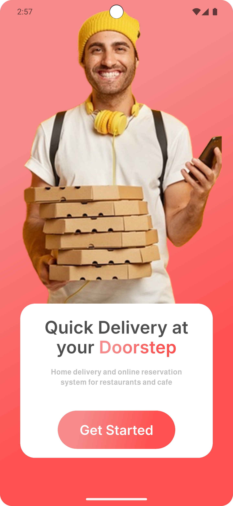
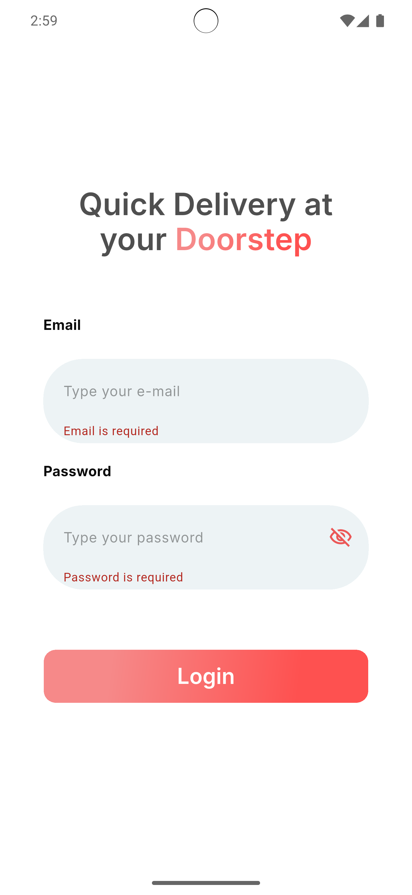
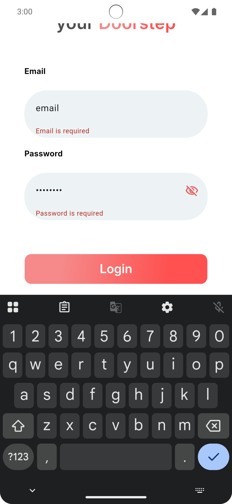
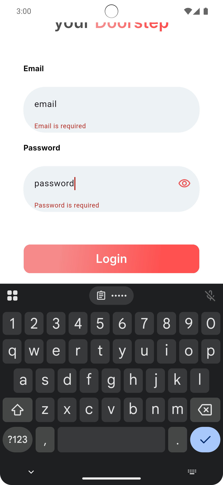
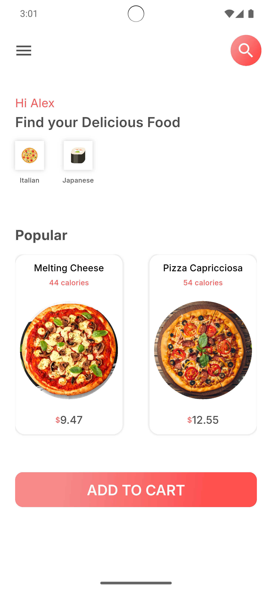
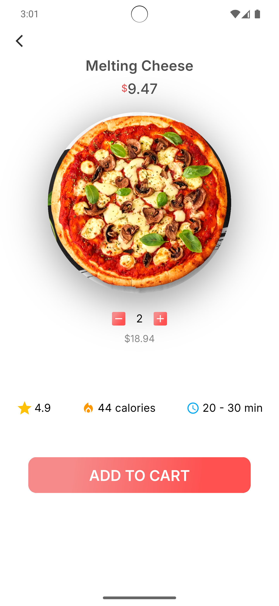

# Food Delivery App 🍔

A modern Flutter food delivery application featuring a clean and user-friendly interface, designed to provide a smooth food browsing and ordering experience.

## 📱 About the App

This is a food delivery app UI project that allows users to explore food items through an attractive and organized interface.

The project includes four main screens, starting with a welcome screen, followed by login, home, and item details screens.

It focuses on responsive UI design, reusable custom widgets, list-based data management, and form validation.

## ✨ Features

- **Start Screen:** Introduces users to the application.
- **Login Screen:** Provides a user-friendly login form.
- **Custom Text Form Field:** Reusable input fields with validation.
- **Form Validation:** Validate user input using custom validators.
- **Home Screen:** Browse and explore available food items.
- **Item Details Screen:** View detailed information about a selected food item.
- **Reusable Custom Widgets:** Maintain consistent UI components across screens.
- **List-Based Data Management:** Organize and display food items using lists.
- **Responsive Design:** Adapt the UI to different screen sizes.
- **Custom Navigation:** Navigate between the application screens.

## 🖥️ Screenshots

### 1. Start Screen

The welcome screen introduces users to the food delivery application.



### 2. Login Screen

Provides a login interface with input fields and validation.








### 3. Home Screen

Displays available food items in an organized and attractive layout.



### 4. Item Details Screen

Shows detailed information about the selected food item.



## 🛠️ Technologies & Packages

- **Flutter** – UI development framework.
- **Dart** – Programming language.
- **flutter_screenutil** – Responsive UI sizing and adaptation.
- **device_preview** – Preview the application on different device sizes.
- **flutter_svg** – Display SVG images and icons.
- **Inter Font** – Typography.
- **Almarai Font** – Typography.
- **Custom Widgets** – Build reusable and maintainable UI components.
- **CustomTextFormField** – Reusable text input widget with validation.
- **Form Validation** – Validate user input using validators.
- **List Data Structures** – Organize and display food item data.

## 📂 Project Structure

```text
final_project/
├── assets/
│   ├── images/
│   └── icons/
│   └── fonts/
├── lib/
│   ├── screens/
│   ├── widgets/
│   ├── data/
│   └── main.dart
├── pubspec.yaml
└── README.md
```

## 🚀 Getting Started

Clone the repository:

```bash
git clone REPOSITORY_URL
```

Navigate to the project directory:

```bash
cd flutter/final_project
```

Install dependencies:

```bash
flutter pub get
```

Run the application:

```bash
flutter run
```

---

**Project Type:** Flutter Food Delivery App  
**Framework:** Flutter  
**Language:** Dart