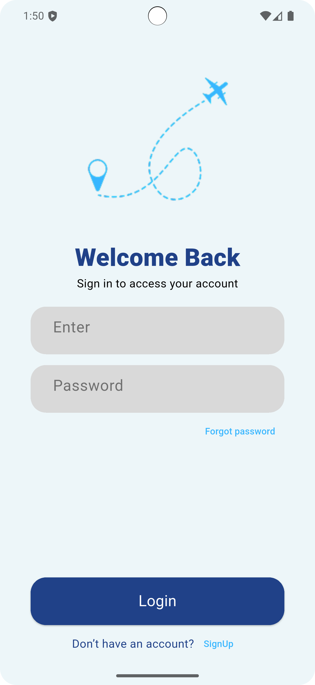
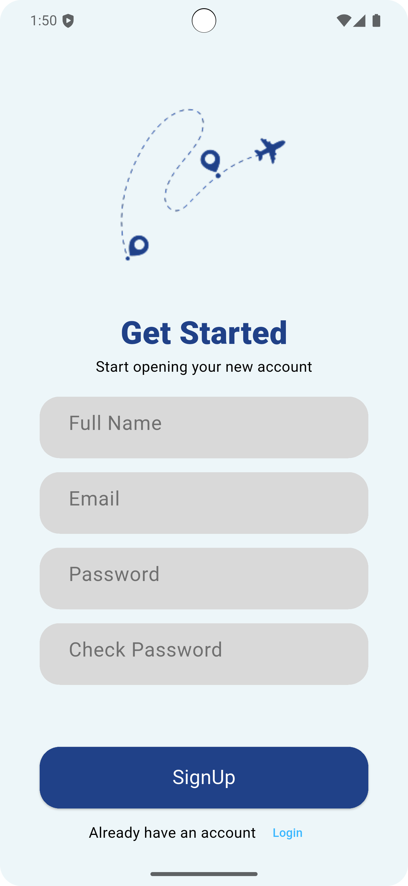
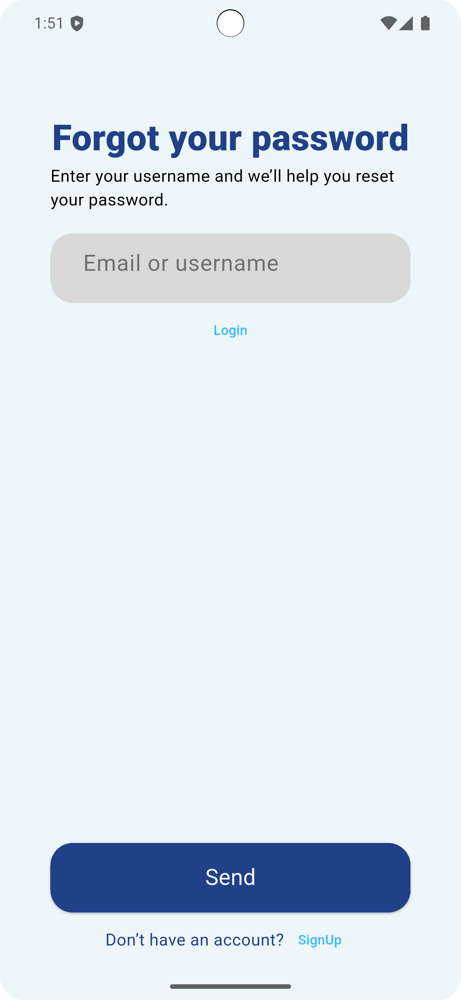

# Flight Authentication UI ✈️

A simple and modern Flutter UI project for a flight application, featuring login, sign-up, and password recovery screens.

## 📱 About the App

It is a simple flight booking app UI concept designed to provide a clean and user-friendly authentication experience.

This project focuses on the visual design of authentication screens without implementing actual login or registration functionality.

## ✨ Features

- Login Screen UI.
- Sign Up Screen UI.
- Forgot Password Screen UI.
- Simple and clean interface.
- User-friendly design.

## 🖥️ Screenshots

### 1. Login Screen



The login screen provides an interface for existing users to enter their account details.


### 2. Sign Up Screen




The sign-up screen presents a form layout for new users to create an account.


### 3. Forgot Password Screen



The forgot password screen provides a simple interface for users who need to recover their account password.


## 🛠️ Technologies & Tools

- **Flutter** – UI development framework.
- **Dart** – Programming language.
- **Assets** – Local images stored in `assets/images/`.

## 📂 Project Structure

```text
practice2/
├── assets/
│   └── images/
├── lib/
├── pubspec.yaml
└── README.md
```

## 🚀 Getting Started

1. Clone the repository:

```bash
git clone REPOSITORY_URL
```

2. Navigate to the project directory:

```bash
cd flutter/practice2
```

3. Install dependencies:

```bash
flutter pub get
```

4. Run the application:

```bash
flutter run
```

---

**Project Type:** Flutter UI Practice
**Framework:** Flutter
**Language:** Dart
