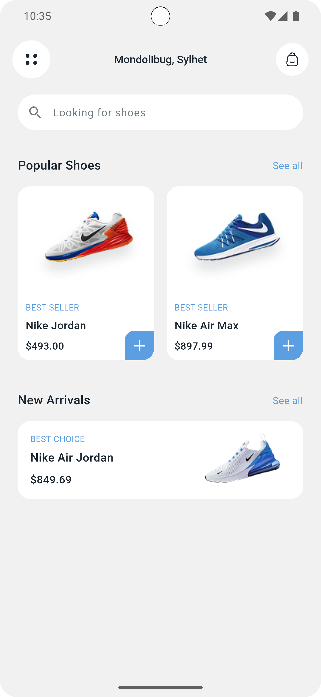
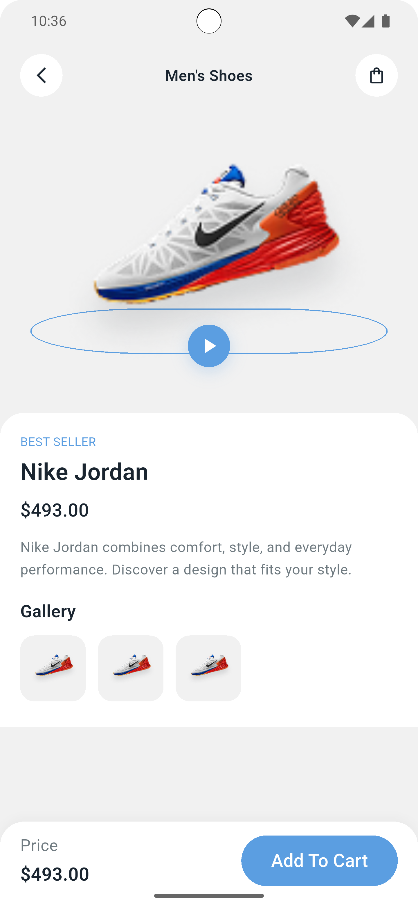

# Shoes Store App 👟

A modern Flutter shoe store application featuring product browsing and detailed product views with a clean and attractive user interface.

## 📱 About the App

It is a shoe shopping app UI project designed to provide a simple and enjoyable product browsing experience.

Users can explore different shoes on the home screen and view individual product details on a dedicated details screen.

The project focuses on responsive UI design, reusable custom widgets, and list-based product data management.

## ✨ Features

- **Home Screen:** Browse and explore available shoes.
- **Product Details Screen:** View information about a selected shoe.
- **Product Listing:** Display multiple shoe products using list-based data.
- **Reusable Custom Widgets:** Build consistent and reusable UI components.
- **Responsive Design:** Adapt the interface to different screen sizes.
- **Custom Navigation:** Navigate between the home and product details screens.

## 🖥️ Screenshots

### 1. Home Screen



### 2. Product Details Screen



## 🛠️ Technologies & Packages

- **Flutter** – UI development framework.
- **Dart** – Programming language.
- **flutter_screenutil** – Responsive UI sizing and adaptation.
- **flutter_svg** – Display SVG images and icons.
- **Inter Font** – Typography.
- **Poppins Font** – Typography.
- **Custom Widgets** – Create reusable UI components.
- **List Data Structures** – Organize and display shoe product data.

## 📂 Project Structure

```text
practice3/
├── assets/
│   ├── images/
│   └── icons/
│   └── fonts/
├── lib/
├── pubspec.yaml
└── README.md
```

## 🚀 Getting Started

```bash
git clone REPOSITORY_URL
cd flutter/practice3
flutter pub get
flutter run
```

---

**Project Type:** Flutter Shoes Store App  
**Framework:** Flutter  
**Language:** Dart