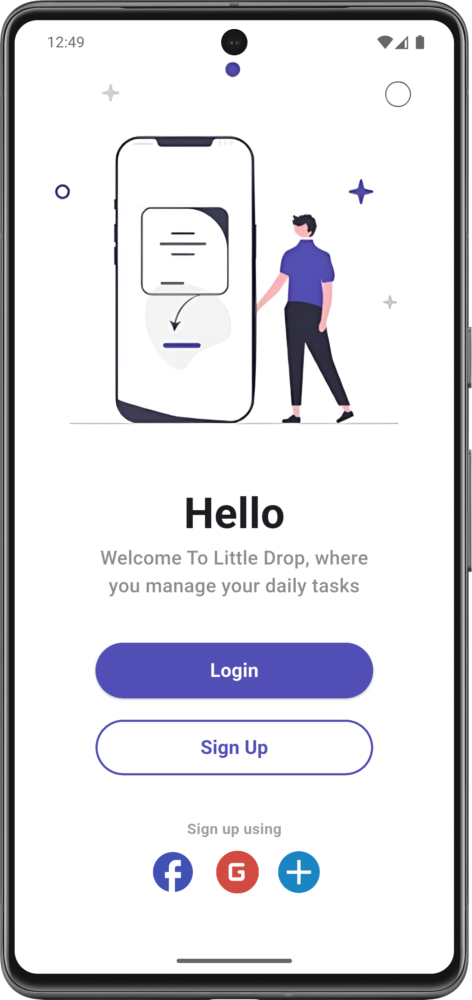

# Welcome UI 👋

A simple and modern Flutter UI project featuring a welcome screen with a clean and user-friendly design.

## 📱 About the App

This project focuses on designing a welcoming first screen for a mobile application. It provides a simple introduction to the app through an attractive and easy-to-use interface.

This is a UI-only project with no backend or functional authentication features.

## ✨ Features

- Welcome Screen UI.
- Clean and simple design.
- User-friendly interface.
- Organized Flutter UI components.

## 🖥️ Screenshot

### Welcome Screen



The welcome screen serves as the first point of interaction with the application, introducing users to its interface.


## 🛠️ Technologies & Tools

- **Flutter** – UI development framework.
- **Dart** – Programming language.
- **Assets** – Local images stored in `assets/images/`.

## 📂 Project Structure

```text
task1/
├── assets/
│   └── images/
├── lib/
├── pubspec.yaml
└── README.md
```

## 🚀 Getting Started

Clone the repository:

```bash
git clone REPOSITORY_URL
```

Navigate to the project directory:

```bash
cd flutter/task1
```

Install dependencies:

```bash
flutter pub get
```

Run the application:

```bash
flutter run
```

---

**Project Type:** Flutter UI Practice  
**Framework:** Flutter  
**Language:** Dart