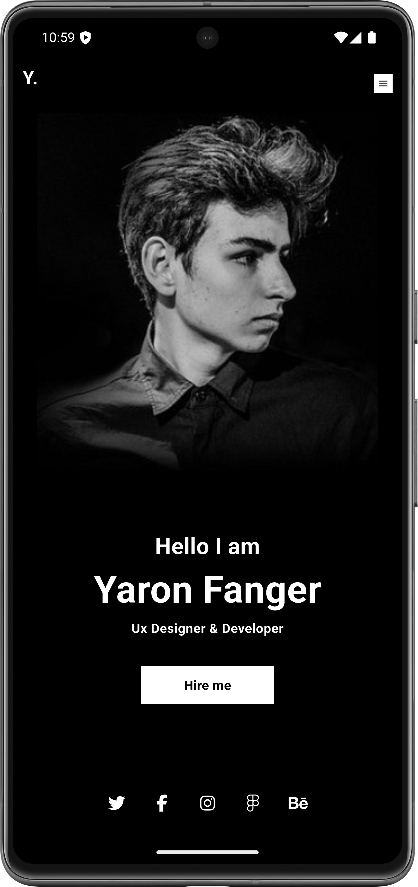
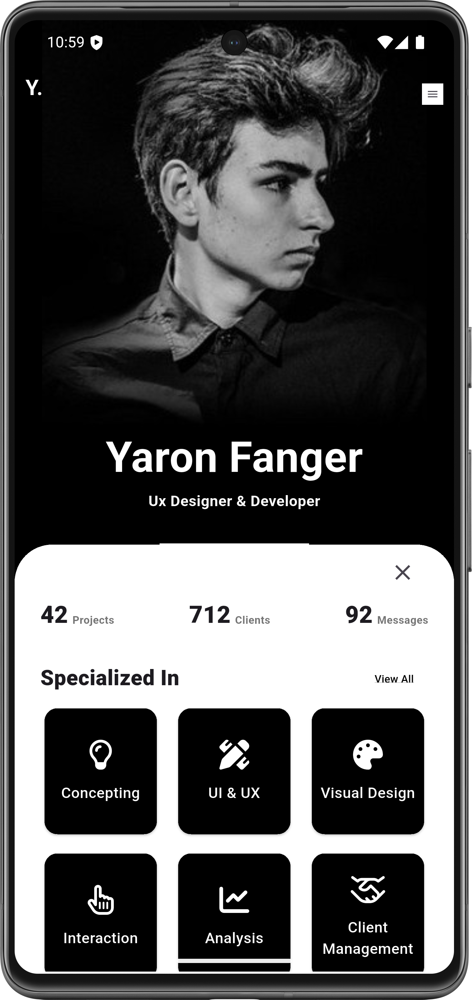

# Portfolio – Interactive Portfolio UI 💼

A modern Flutter portfolio UI featuring a clean personal portfolio layout and an interactive draggable bottom sheet.

## 📱 About the App

This project is a single-screen portfolio UI designed to present personal information and portfolio content in a simple and organized way.

It demonstrates the use of Flutter's `DraggableScrollableSheet` to create an interactive, resizable content area that users can drag up and down.

This project focuses on UI design and interaction without backend functionality.

## ✨ Features

- Single-screen portfolio interface.
- Interactive `DraggableScrollableSheet`.
- Expandable and draggable content area.
- Clean and organized UI layout.
- Custom icons using Font Awesome.

## 🖥️ Screenshots

### 1. Portfolio Screen



The main portfolio interface presenting the app's layout and content.

### 2. Draggable Sheet Interaction



Shows the draggable sheet in a different position, demonstrating its interactive behavior.

## 🛠️ Technologies & Packages

- **Flutter** – UI development framework.
- **Dart** – Programming language.
- **font_awesome_flutter** – Font Awesome icons.
- **DraggableScrollableSheet** – Flutter widget for creating draggable, resizable scrollable sheets.
- **Assets** – Local images stored in `assets/images/`.

## 📂 Project Structure

```text
task2/
├── assets/
│   └── images/
├── lib/
├── pubspec.yaml
└── README.md
```

## 🚀 Getting Started

Clone the repository:

```bash
git clone REPOSITORY_URL
```

Navigate to the project directory:

```bash
cd flutter/task2
```

Install dependencies:

```bash
flutter pub get
```

Run the application:

```bash
flutter run
```

---

**Project Type:** Flutter UI Practice  
**Framework:** Flutter  
**Language:** Dart