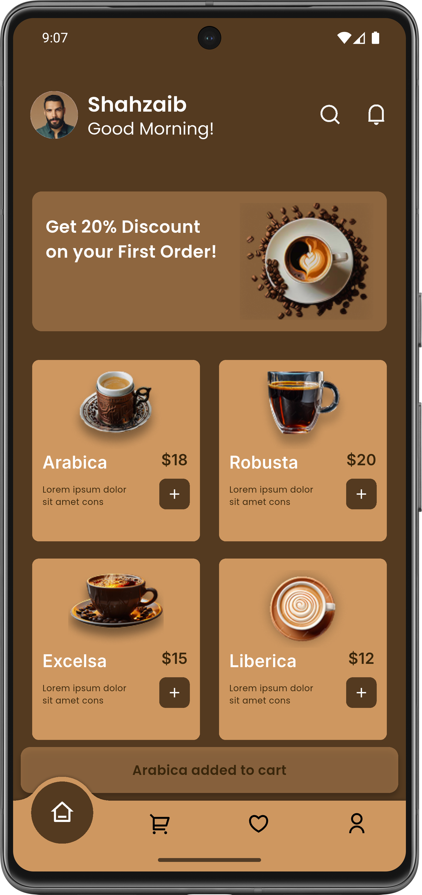
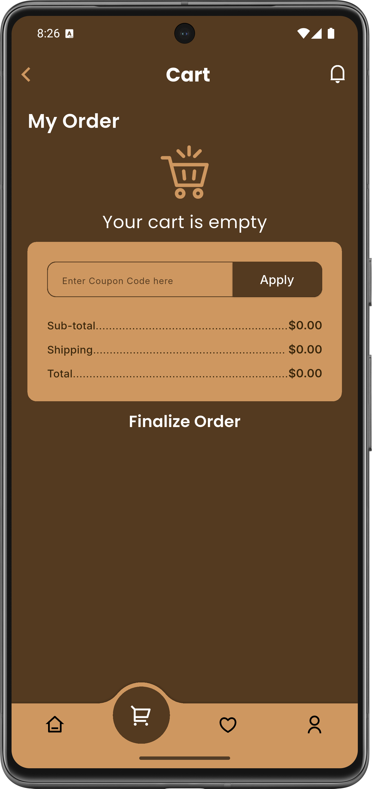
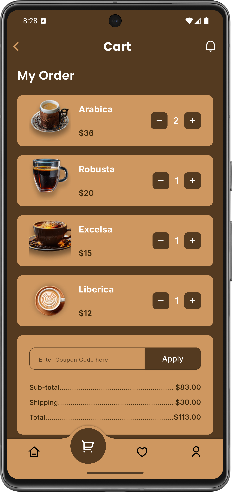
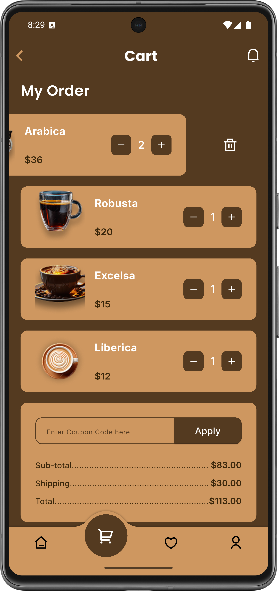
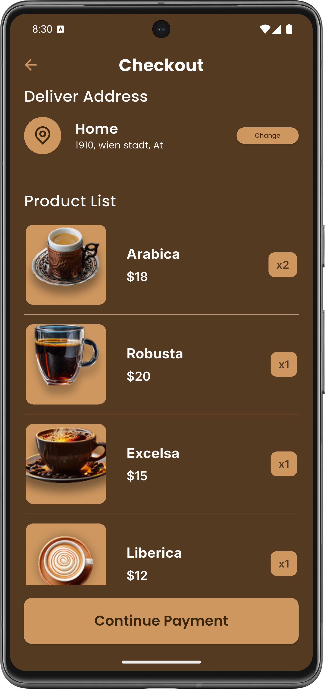

# Coffee Shop App ☕

A modern Flutter coffee shop application featuring product browsing, cart management, and a checkout interface with a clean and user-friendly design.

## 📱 About the App

This is a coffee shop application designed to provide a smooth shopping experience. Users can explore coffee products, add items to their cart, manage quantities, and view the order summary before checkout.

The project focuses on Flutter UI development, reusable custom widgets, and local cart state management.

## ✨ Features

- **Home Screen:** Browse and explore available coffee products.
- **Cart Screen:** View added products and manage item quantities.
- **Checkout Screen:** Display the order summary and total price.
- **Cart Management:** Add and remove products from the cart.
- **Quantity Management:** Increase product quantities when adding an existing item.
- **Price Calculation:** Automatically calculate subtotal, shipping fees, and total price.
- **Reusable Custom Widgets:** Organized and reusable UI components.
- **List-Based Data Management:** Store and manage product and cart data using lists.
- **Reactive Cart Updates:** Use `ValueNotifier` to update the cart interface when its data changes.

## 🖥️ Screenshots

### 1. Home Screen

Explore the available coffee products through the main shopping interface.



### 2. Cart Screen

View selected products, update quantities, and manage cart items.







### 3. Checkout Screen

Review the order details, including subtotal, price.



## 🛠️ Technologies & Packages

- **Flutter** – UI development framework.
- **Dart** – Programming language.
- **flutter_screenutil: ^5.9.3** – Responsive UI sizing and adaptation.
- **device_preview: ^1.3.1** – Preview the application on different device sizes.
- **flutter_svg: ^2.3.0** – Display SVG images and icons.
- **convex_bottom_bar: ^3.2.0** – Custom bottom navigation bar.
- **ValueNotifier** – Reactive local state management for cart updates.
- **Custom Widgets** – Build reusable UI components.
- **List Data Structures** – Organize and manage product and cart data.

## 🛒 Cart Management Logic

The cart uses a `ValueNotifier<List<CartItem>>` to manage its state.

Main cart operations include:

- `addToCart()` – Add a product or increase its quantity if it already exists.
- `updateCart()` – Notify listeners when cart data changes.
- `removeFromCart()` – Remove an item from the cart.
- `subTotal` – Calculate the total price of all cart items.
- `shipping` – Calculate the shipping fee.
- `totalPrice` – Calculate the final price including shipping.

The shipping fee is set to 30 when the cart contains items, and 0 when the cart is empty.

## 📂 Project Structure

```text
task3/
├── assets/
│   ├── images/
│   └── icons/
├── lib/
│   ├── data/
│   ├── screens/
│   ├── widgets/
│   └── main.dart
├── pubspec.yaml
└── README.md
```

## 🚀 Getting Started

Clone the repository:

```bash
git clone REPOSITORY_URL
```

Navigate to the project directory:

```bash
cd flutter/task3
```

Install dependencies:

```bash
flutter pub get
```

Run the application:

```bash
flutter run
```

---

**Project Type:** Flutter Coffee Shop App
**Framework:** Flutter
**Language:** Dart
